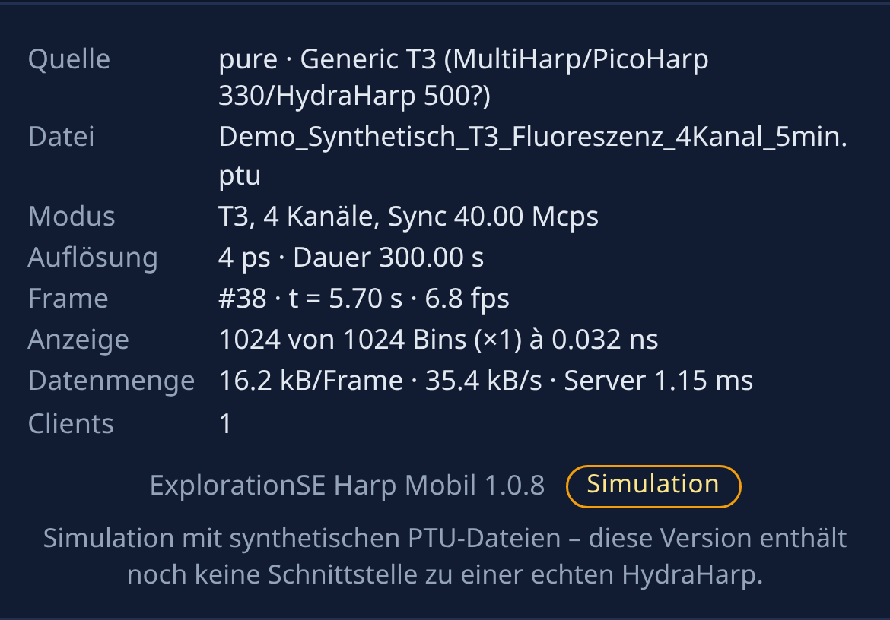

# ExplorationSE Harp Mobil

[](https://github.com/ExplorationSE/harp-mobil/actions/workflows/tests.yml)
[](LICENSE)

Live-Histogramme, Korrelationen und Zählraten für eine PicoQuant **HydraHarp 500** auf dem Smartphone – mit
Steuerung im Browser (PWA); derzeit **Simulation aus PTU-Dateien, noch ohne Geräteanbindung**.

> [!IMPORTANT]
> **Hinweis – bitte zuerst lesen**
> - **Noch keine Anbindung an eine echte HydraHarp.** Version 1.0 spielt ausschließlich **PTU-Dateien als
>   Simulation** ab. Die snAPI-Quelle (PTU-Wiedergabe über snAPI) ist unter Windows **ungetestet**, die
>   Live-Quelle für das echte HydraHarp-500-Gerät ist nur ein **Platzhalter**.
> - **Erstellt ausschließlich aus öffentlich verfügbaren Informationen:** öffentliche Handbücher und Downloads
>   von PicoQuant, das öffentliche GitHub-Repository [PicoQuant/snAPI](https://github.com/PicoQuant/snAPI) und die
>   [PTU-Format-Demos](https://github.com/PicoQuant/PicoQuant-Time-Tagged-File-Format-Demos). Dieses Repository
>   enthält **keine Dateien von PicoQuant** (keine DLLs, Header, Demo-Code oder snAPI-Wheels); die Demodaten sind
>   synthetisch erzeugt.
> - **Kein Produkt der PicoQuant GmbH**, nicht mit ihr verbunden und nicht von ihr unterstützt oder geprüft.
>   HydraHarp, PicoQuant, snAPI und SymPhoTime sind Marken ihrer jeweiligen Inhaber.
> - **Ohne Gewährleistung** (MIT-Lizenz); nicht für sicherheitskritische Anwendungen bestimmt.

**Download:** [aktuelle Version (Programm, Demodaten, Anleitung als PDF)](https://github.com/ExplorationSE/harp-mobil/releases/latest)
· Änderungen: [`CHANGELOG.md`](CHANGELOG.md) · Lizenz: [MIT](#13-lizenz)

<p>
  
  
</p>

## Funktionen

- **Drei Ansichten:** Histogramm (Zeit nach Sync bzw. nach Referenzkanal), Korrelation g² (τ = t(Kn) − t(Kref),
  T2 und T3) und Zählraten-Zeitverlauf; logarithmische y-Achse, Kanäle einzeln ein-/ausblendbar.
- **T2 und T3**, Sync bei T2 als eigener Datenkanal **K0** (z. B. Herald-Detektor), Referenzkanal wählbar.
- **Steuerung vom Handy:** Start/Stopp/Reset, Binbreite, Länge, Tempo, Akkumulieren oder gleitendes Fenster;
  ein Client steuert, weitere sehen live mit.
- **Windows-Betrieb** mit Skripten; Zugriff im LAN oder über das Internet (Cloudflare Quick Tunnel, Zugangscode, QR-Code).
- **Simulation** (noch ohne Geräteanbindung) durch Wiedergabe von `.ptu`-Dateien in Echtzeit; drei Demodateien im Release.
- Server: Python/FastAPI/WebSocket, Oberfläche: uPlot, getestet mit pytest.

Version: einzige Quelle `harp/__init__.py` (`__version__`), abrufbar über `/api/health`.

In Version 1.0 kommen die Daten **nicht vom echten Gerät**, sondern aus einer
**Messsimulation mit einer `.ptu`-Datei**, die in Echtzeit abgespielt wird.

> Status: funktionsfähiger Prototyp. Die reine Python-Quelle ist vollständig getestet. Die snAPI-Quelle
> wurde unter **Linux** mit dem offiziellen snAPI-Wheel 1.2.5 (File-Device) getestet, **unter Windows
> noch nicht**. Die Quelle für das echte HH500-Gerät ist nur ein **Platzhalter**.

---

## 1. Architektur

```
 Messrechner (Windows)                                             Smartphone / Tablet / PC
┌───────────────────────────────────────────────────────────┐     ┌─────────────────────────┐
│  Datenquelle (wählbar in config.toml)                     │     │ Browser (PWA-fähig)     │
│   ├─ PurePythonPtuSource  PTU lesen + NumPy-Histogramm     │     │  index.html + app.js    │
│   ├─ SnapiPtuSource       snAPI File-Device + Histogram   │     │  uPlot (lokal, kein CDN)│
│   │                       (eigener Worker-Prozess)        │     │                         │
│   └─ HH500LiveSource      Platzhalter für echtes Gerät    │     │  • Histogramm (log)     │
│              │ Frame (Histogramm-Inkrement, Zählungen)    │     │  • Zählraten            │
│              ▼                                            │     │  • Zählraten-Verlauf    │
│  HarpService (FastAPI/uvicorn)                            │ WS  │  • Steuerung            │
│   • Akkumulieren / gleitendes Fenster                     │◄───►│                         │
│   • Rebinning für die Anzeige (≤ display_points)          │JSON │                         │
│   • Validierung, Steuer-Sperre, Befehlsprotokoll          │     │                         │
└───────────────────────────────────────────────────────────┘     └─────────────────────────┘
```

* **Kein TTTR-Rohdatenstrom zum Handy**: Histogrammiert wird ausschließlich auf dem Messrechner. Zum Client
  gehen nur die (ggf. zusammengefassten) Histogramm-Arrays, Zählraten und Statusinformationen mit 5–10 Hz.
* **Takt**: Der Server liest pro Frame `Frame-Intervall × Tempo` Messzeit aus der Quelle (z. B. 150 ms × 1 = 150 ms)
  und wartet dann bis zum nächsten Frame. Die aufgezeichnete Zeitbasis der PTU-Datei wird damit eingehalten.
* **Protokoll**: WebSocket `/ws`, JSON-Nachrichten
  * Server → Client: `status` (Einstellungen, Quelle, Dateien, Steuer-Status), `frame` (Histogramme, Raten),
    `trace` (bisheriger Zählratenverlauf bei Verbindungsaufbau), `ack` (Antwort auf Befehle)
  * Client → Server: `{"type":"command","cmd":"set","params":{"binning":4},"id":1}`
* REST: `GET /api/health`, `GET /api/status`, `GET /api/files`.

### Verzeichnisstruktur

| Pfad | Inhalt |
|---|---|
| `run_server.py` | Startskript (uvicorn) |
| `config.toml` | Konfiguration (Port, Quelle, Datenordner, Token, Standardwerte) |
| `harp/ptu.py` | PTU-Reader/-Writer (Header-Tags, T2/T3-Records, Overflow-Korrektur) |
| `harp/histogram.py` | Histogrammierung T3/T2, Akkumulator, Rebinning |
| `harp/sources/` | Datenquellen: `pure_ptu.py`, `snapi_ptu.py`, `hh500_live.py` (Stub) |
| `harp/control.py` | Einstellungen + Wertebereiche, Steuer-Sperre, Befehlsprotokoll |
| `harp/server.py` | FastAPI-App, WebSocket, Messschleife |
| `harp/auth.py` | Zugangscode, Anmeldeseite, Sitzungs-Cookie, Fehlversuch-Sperre, Origin-Prüfung |
| `web/` | Web-App (HTML/CSS/JS, `vendor/uPlot` lokal, Manifest, Service Worker) |
| `data/` | PTU-Dateien (Demo: `Demo_Synthetisch_T3_Fluoreszenz_4Kanal_5min.ptu`, `Demo_Synthetisch_T2_Einzelphotonen_HBT_90s.ptu`, `Demo_Synthetisch_T2_Heralded_K0_HBT_60s.ptu`) |
| `tools/generate_ptu.py` | Generator für synthetische PTU-Dateien |
| `tools/crosscheck.py` | Gegenprobe des Readers mit `ptufile` und `phconvert` |
| `tools/ws_client_check.py` | End-to-End-Test gegen den laufenden Server |
| `tools/screenshot.py` | Headless-Screenshots (Playwright) |
| `tools/print_online_info.py` | Ausgabe von Adresse, Code und QR-Code beim Online-Start |
| `install_windows.bat` | Einmalige Installation (Python-venv + Pakete) |
| `start_server.bat` | Start für diesen PC / lokales Netz (ohne Tunnel) |
| `start_online.bat` + `start_online.ps1` | Start mit Zugangscode + Cloudflare Quick Tunnel (Internet) |
| `stop_online.bat` + `stop_online.ps1` | Beendet Server und Tunnel des Online-Starts |
| `stop_online.sh` | Linux-Gegenstück zum Beenden (Entwicklungsrechner) |
| `ANLEITUNG_WINDOWS.md` | Schritt-für-Schritt-Anleitung für den Online-Betrieb unter Windows |
| `tests/` | pytest-Tests |
| `logs/commands.jsonl` | Protokoll aller Steuerbefehle (Zeit, Client, Adresse, Befehl, Ergebnis) |

---

## 2. Installation unter Windows

Voraussetzungen: Windows 10/11 (64 Bit), Internet für die einmalige Installation.

1. **Python 3.13 (64 Bit)** von <https://www.python.org/downloads/> installieren („Add python.exe to PATH“ ankreuzen).
   PicoQuant empfiehlt in der snAPI-Installationsanleitung Python 3.13; snAPI selbst verlangt Python ≥ 3.10.
2. Projektordner entpacken, z. B. nach `C:\HarpMobile\v1`.
3. Doppelklick auf **`install_windows.bat`** (sucht Python, legt `.venv` an, installiert `requirements.txt`) –
   oder manuell in der Eingabeaufforderung:
   ```bat
   cd C:\HarpMobile\v1
   py -3.13 -m venv .venv
   .venv\Scripts\activate
   pip install -r requirements.txt
   ```
   `requirements.txt` enthält nur Pakete, für die fertige Windows-Wheels (win_amd64, Python 3.12–3.14) existieren
   (FastAPI, uvicorn[standard], NumPy, qrcode, pytest, httpx) – es wird kein C-Compiler benötigt (geprüft mit
   `pip download --platform win_amd64 --only-binary=:all:`). Optionale Werkzeuge stehen in
   `requirements-optional.txt` (ptufile, phconvert, playwright, snAPI).
4. **Nur für die snAPI-Quelle bzw. später das echte Gerät** (laut snAPI-Doku *Installation*):
   * Microsoft Visual C++ Redistributable (x64) installieren, falls nicht vorhanden:
     <https://aka.ms/vs/17/release/vc_redist.x64.exe>
   * `pip install snAPI`
   * Für das echte Gerät zusätzlich das HydraHarp-500-Softwarepaket (Treiber) installieren:
     <https://downloads.picoquant.com/software/HydraHarp500/Hydraharp_500_Release_v1.0.0.0.zip>
     und das Gerät einmal mit der PicoQuant-Software prüfen.
   * Kontrolle: `python -c "import snAPI"` darf keinen Fehler melden.

## 3. Starten

**Über das Internet (Handy mit mobilen Daten):** `start_online.bat` – siehe Abschnitt 4a und die ausführliche
[ANLEITUNG_WINDOWS.md](ANLEITUNG_WINDOWS.md).

**Nur an diesem PC bzw. im lokalen Netz:**
```bat
start_server.bat
```
oder
```bat
.venv\Scripts\activate
python run_server.py                 REM Einstellungen aus config.toml
python run_server.py --port 9000     REM anderer Port
python run_server.py --source snapi  REM snAPI-Quelle statt reinem Python
```

Am Messrechner selbst: <http://localhost:8765/>.
Beim Start wird `default_file` geöffnet und (bei `autostart = true`) sofort abgespielt.

## 4. Öffnen auf dem Smartphone im LAN

1. Handy und Messrechner müssen im **selben (vertrauenswürdigen) Netz** sein.
2. IP-Adresse des Messrechners ermitteln: `ipconfig` → „IPv4-Adresse“, z. B. `192.168.1.50`.
3. Windows-Firewall für den Port öffnen (Eingabeaufforderung **als Administrator**, nur Profil „Privat“):
   ```bat
   netsh advfirewall firewall add rule name="Harp Mobil" dir=in action=allow protocol=TCP localport=8765 profile=private
   ```
4. Am Handy im Browser öffnen: `http://192.168.1.50:8765/` (mit Token: `http://192.168.1.50:8765/?token=IHR_TOKEN`).
5. Optional „Zum Startbildschirm hinzufügen“. Hinweis: Der Service Worker (Offline-App-Hülle) wird von
   Browsern nur über **HTTPS** oder `localhost` aktiviert; über `http://<IP>` funktioniert die Seite
   vollständig, aber ohne Offline-Cache.

## 4a. Zugriff über das Internet (Cloudflare Quick Tunnel)

`start_online.bat` (ruft `start_online.ps1` auf) erledigt:

1. erzeugt einen zufälligen **Zugangscode** (10 Zeichen aus `ABCDEFGHJKMNPQRSTUVWXYZ23456789`, also ohne 0/O, 1/I/L)
   – oder übernimmt `HARP_TOKEN`, falls gesetzt;
2. startet den Server **nur auf `127.0.0.1:8765`** (von außen nicht direkt erreichbar) mit diesem Code;
3. lädt bei Bedarf `cloudflared.exe` vom offiziellen GitHub-Release
   (`https://github.com/cloudflare/cloudflared/releases/latest/download/cloudflared-windows-amd64.exe`) nach `tools\`
   – oder nutzt ein bereits installiertes (`winget install --id Cloudflare.cloudflared`);
4. startet `cloudflared tunnel --no-autoupdate --url http://127.0.0.1:8765` (Quick Tunnel, kein Konto nötig),
   liest die `https://….trycloudflare.com`-Adresse aus `logs\cloudflared.log` und zeigt Adresse, Code,
   Direkt-Link `…/?token=CODE` und einen QR-Code an;
5. beendet beides, wenn im Fenster Enter gedrückt wird; alternativ `stop_online.bat`.

Technische Details:

* **Anmeldung**: Ohne gültige Sitzung leitet jede Seite auf `/login` um, `/api/*` antwortet mit 401, der WebSocket
  wird abgewiesen (HTTP 403). Nach Eingabe des Codes (oder Aufruf von `/?token=CODE`) setzt der Server ein
  Sitzungs-Cookie (`HttpOnly`, `SameSite=Lax`, hinter dem Tunnel zusätzlich `Secure`, gültig 7 Tage oder bis zum
  Neustart). Fehlversuche: Sperre je Client-IP und global (Bremse gegen Durchprobieren).
* **Hinter cloudflared**: cloudflared reicht den öffentlichen Hostnamen als `Host` weiter und setzt
  `X-Forwarded-For`/`X-Forwarded-Proto: https`/`CF-Connecting-IP`. uvicorn übernimmt `X-Forwarded-*` nur von
  127.0.0.1 (Standard `forwarded_allow_ips`), `CF-Connecting-IP` wird ebenfalls nur von localhost akzeptiert.
  Die WebSocket-**Origin-Prüfung** vergleicht den Hostnamen der Origin (`https://abc.trycloudflare.com`) mit
  `Host` bzw. `X-Forwarded-Host` (Groß-/Kleinschreibung und Standardports werden normalisiert) – fremde Origins werden
  abgewiesen (Schutz gegen Cross-Site-WebSocket-Hijacking).
  Grundlage: cloudflared-Quelltext `ingress/origin_proxy.go` (`httpService.RoundTrip`) – der ursprüngliche `Host`
  bleibt erhalten; nur wenn `httpHostHeader` konfiguriert ist, wird er ersetzt und als `X-Forwarded-Host`
  weitergegeben (<https://github.com/cloudflare/cloudflared/blob/master/ingress/origin_proxy.go>).
* Logs: `logs\server-online.log`, `logs\cloudflared.log`; `logs\online_info.txt` enthält Adresse und Code und wird
  beim Beenden gelöscht.
* Falls QUIC/UDP im Netz gesperrt ist: vor dem Start `set HARP_TUNNEL_PROTOCOL=http2`.

## 5. Bedienung und Bezug zum echten Gerät

Jede Änderung in der Oberfläche wird als Befehl an den Server geschickt und dort **validiert**. Es darf immer
nur **ein Client steuern** (Knopf „Steuerung übernehmen“; die erste Änderung übernimmt die Steuerung automatisch,
sofern frei). Die Sperre wird beim Trennen oder nach `lock_timeout_s` Inaktivität frei. Alle anderen Clients
sehen die Daten nur an. Jeder Befehl wird in `logs/commands.jsonl` protokolliert.

| Bedienelement | Bereich (Server-Prüfung) | Simulation (1.0) | Spätere Abbildung am HH500 (snAPI) [ungeprüft] |
|---|---|---|---|
| Start / Stopp | – | Wiedergabe starten / pausieren | `histogram.measure()` / `stopMeasure()` |
| Reset | – | Akkumulation + Verlauf löschen | `histogram.clearMeasure()` |
| Von vorn | – | Datei zurückspulen | – |
| Frame-Intervall | 100–2000 ms | Anzeige-/Integrationstakt | Sequence-Fenster (`setSequenceMode(Timer, param)`) |
| Wiedergabe-Tempo | 0,05–100 (1 = „Echtzeit“) | Messzeit pro Frame = Intervall × Tempo | entfällt (Echtzeit) |
| Binbreite (Binning-Code) | 0–15 | Bin = Dateiauflösung × 2^n; angezeigt wird nur die Breite | `device.setBinning()` |
| Histogrammlänge | Code 0–7 (1024…131072 Bins) | Länge des Histogramms | `device.setHistoLength()` (2^(10+Code)) |
| Modus | Akkumulieren / gleitend (2–300 Frames) | serverseitig | serverseitig |
| Kanäle (API `channels`) | 1…Anzahl Kanäle der Quelle | Auswahl der übertragenen Kanäle; beim Öffnen einer Datei alle | zusätzlich `device.setInputChannelEnable()` |
| Referenzkanal (g²) / Binbreite g² | `ref_channel` 1…n / `corr_binning` | Korrelationsansicht | – |
| Anzeige-Punkte | 64–8192 | Rebinning nur für die Übertragung | gleich |
| PTU-Datei | nur Dateien in `data/` (kein Pfad) | Datei wechseln | entfällt |
| K0–K4-Tasten, Ansicht Histogramm/Korrelation/Zeitverlauf | (nur im Client) | Ein-/Ausblenden, y-Achse Histogramm immer log | – |

## 6. Eigene / echte PTU-Datei verwenden

1. Datei (`*.ptu`) in den Ordner `data/` kopieren (oder `data_dir` in `config.toml` ändern).
2. In der Oberfläche unter „PTU-Datei“ auswählen – oder in `config.toml` `default_file = "meine.ptu"` setzen.
3. Unterstützte Record-Typen (reine Python-Quelle): PicoHarp 300 T2/T3, HydraHarp V1/V2 T2/T3,
   TimeHarp 260 N/P T2/T3, Generic T2/T3 (MultiHarp, PicoHarp 330). **Welchen Record-Typ die HydraHarp 500
   schreibt, ist nicht verifiziert** [unsicher]; die synthetische Datei verwendet Generic T3 (`0x00010307`).
   Eine echte HH500-Datei sollte als Erstes mit `python tools/crosscheck.py data\meine.ptu` geprüft werden.
4. Drei Ansichten (Umschalter über dem Diagramm, Handy: „Histo | g² | Zeit“), für T2 und T3 gleichermaßen:
   * **Histogramm** (Start-Stopp, log): T3 → Mikrozeit (dtime, Start = Sync); T2 → Zeit seit dem letzten
     Ereignis auf dem **Referenzkanal** (ersetzt den Sync; Achse „t nach K1 / ns“, Referenz ohne eigene Kurve).
     T2-Startwert: 1024 Bins über ≈ 10 Sync-Perioden (HBT-Demo: 1,024 ns, 0–1 µs).
   * **Zeitverlauf**: Zählraten (kcps) über der Dateizeit.
   * **Korrelation** (log, x-Bereich symmetrisch um τ = 0, Diagramm in der Karte zentriert): Zeitdifferenz-Histogramm τ = t(Kn) − t(Kref) für jeden Kanal außer dem
     **Referenzkanal** (Auswahl „Referenzkanal (g²)“, K1…Kn; der Referenzkanal hat keine eigene Kurve).
     T3 nutzt die absolute Zeit nsync × Sync-Periode + dtime × Auflösung. Fenster symmetrisch,
     2048 Bins; Binbreite „Binbreite g²“ wird beim Öffnen so gewählt, dass das Fenster ≈ ±5 Sync-Perioden umfasst
     (T3-Demo 128 ps → ±131 ns, T2-HBT-Demo 512 ps → ±524 ns). Gezählt werden **alle** Paare im Fenster,
     auch über Frame-Grenzen hinweg genau einmal (`harp/histogram.py: correlate`, Tests in
     `tests/test_correlation.py`). Keine Normierung auf g²(τ) (Rohzählungen).
   Server berechnet Histogramm und Korrelation in jedem Frame (gering, getrennt akkumuliert) und sendet beide.
   Dateiliste: jede Datei genau einmal (früher Doppelte unter Windows, weil `*.ptu` und `*.PTU` auf dem
   nicht case-sensitiven Dateisystem dieselben Dateien fanden).
   Beim Öffnen einer Datei werden Binbreite und Länge auf Startwerte gesetzt: T3 → Standard
   (Auflösung × 8, 1024 Bins); T2 → 4096 Bins und Binbreite so, dass das Fenster ≈ 10 Sync-Perioden
   (±5 Perioden) umfasst (Demo: 256 ps, ±524 ns). Die Sync-Rate-Kachel zeigt bei T2-Dateien ohne
   aufgezeichnete Sync-Ereignisse die Rate aus dem Header (`TTResult_SyncRate`).
5. Sehr große Dateien: Die Datei wird speichergemappt und blockweise dekodiert; beim Öffnen erfolgt ein
   schneller Durchlauf zur Bestimmung von Dauer und Kanälen (bei mehreren GB einige Sekunden).

Synthetische Dateien erzeugen:
```bat
python tools\generate_ptu.py --out data\Demo_Synthetisch_T3_Fluoreszenz_4Kanal_5min.ptu --duration 300 --rates 5000,7500,10000,3500
python tools\generate_ptu.py --hbt --out data\Demo_Synthetisch_T2_Einzelphotonen_HBT_90s.ptu --duration 90
python tools\generate_ptu.py --heralded --seed 7 --out data\Demo_Synthetisch_T2_Heralded_K0_HBT_60s.ptu --duration 60
python tools\generate_ptu.py --out data\mein_test.ptu --duration 60 --rates 50000,80000,120000,30000 --taus 0.5,1.5,3,6
python tools\generate_ptu.py --t2 --sync 1e6 --duration 2 --out data\t2_mit_sync.ptu
```
**`Demo_Synthetisch_T3_Fluoreszenz_4Kanal_5min.ptu`** (39,6 MB, 5 min Echtzeit, Generic T3): Sync 40 MHz (Periode 25 ns),
Auflösung 4 ps, 4 Kanäle mit Lebensdauern 0,6 / 1,8 / 3,2 / 4,5 ns, Gauß-IRF (σ = 50 ps) bei 3 ns, 3 % Untergrund,
zeitlich variierende Intensitäten (K1 Blinken, K2 Sinus 0,2 Hz, K3 Rampe, K4 konstant); mittlere Raten
ca. 2,9 / 4,5 / 7,5 / 3,5 kcps (bewusst moderat, damit die Datei trotz 5 min klein bleibt).

**`Demo_Synthetisch_T2_Einzelphotonen_HBT_90s.ptu`** (17,8 MB, 90 s, Generic T2, 1 ps): abstrahierte Einzelphotonenquelle,
gepulst angeregt mit 10 MHz (Periode 100 ns; Sync nicht aufgezeichnet, Rate im Header), Hanbury-Brown-Twiss-Aufbau
mit 50:50-Strahlteiler auf K1 und K2 (je ≈ 16 kcps), Lebensdauer 1,5 ns, Jitter 60 ps, K2 um 1,2 ns verzögert.
Höchstens ein Photon pro Puls plus kleiner Mehrphotonen-Anteil, Blinken der Quelle (an ≈ 1,5 µs, aus ≈ 1,0 µs),
250 cps Dunkelzählungen je Detektor. In der Korrelationsansicht sichtbar: Peaks im Abstand von 100 ns,
**stark unterdrückter Mittelpeak** (gemessen g²(0) ≈ 0,3 relativ zu den Peaks bei ±400/500 ns, also < 0,5 →
Einzelphotonen-Charakter) und **Bunching-Schultern** (Peaks bei ±100 ns ≈ 1,2× höher als bei ±500 ns) durch das
Blinken. Gegenprobe mit `ptufile`: identische Zeiten und Kanäle.

**`Demo_Synthetisch_T2_Heralded_K0_HBT_60s.ptu`** (28,2 MB, 60 s, Generic T2, 1 ps): Herald-Einzelphotonen aus einer
SPDC-artigen Paarquelle mit Dauerstrich-Pumpe (kein Puls-Takt). **K0** = Herald-Detektor (Idler) am Sync-Eingang
(≈ 70 kcps), **K1/K2** = Signalarm hinter 50:50-Strahlteiler (je ≈ 10 kcps, davon 1 kcps Dunkelzählungen).
Koinzidenzen K0–K1 bei +12 ns und K0–K2 bei +15 ns, Detektor-Jitter 25 ps je Detektor (Peak-FWHM ≈ 85 ps),
Peak/Untergrund ≈ 10⁴ (Zufallskoinzidenzen R0·R1·Δτ). Unbedingte Korrelation K1–K2: flach (Signal-Photonen
verschiedener Paare unkorreliert, thermisches Bunching nur innerhalb der ps-Kohärenzzeit, hier vernachlässigt).
Das bedingte Antibunching (K1–K2 nur bei Herald, Dreifach-Koinzidenzen) wird nicht ausgewertet.
Statt 90 s nur 60 s, damit das Datenpaket unter 25 MB bleibt (gepackt ≈ 21 MB; ein Drittel der Records sind
Überlauf-Records des 1-ps-Zeittakts). Beim Öffnen: Referenzkanal K0, Histogramm 64 ps × 1024 (0–65 ns),
Korrelation 64 ps, ±65 ns.
Gegenprobe mit `ptufile` 2026.8.8: Zeiten identisch; `ptufile` meldet Sync-Records in T2 allerdings als
Kanal 0, also genauso wie Eingang 1 (dessen Kanal 0-basiert ist). K0 und K1 sind dort nur über die Record-Bits
unterscheidbar. Der Harp-Mobil-Leser folgt dem PicoQuant-Formatbeispiel: Spezial-Record mit Kanal 0 = Sync → K0.

**Sync als Datenkanal K0 (T2):** Bei T2 ist der Sync-Eingang des HydraHarp ein normaler Zeitkanal; die
Sync-Ereignisse stehen mit Zeitstempel in der Datei (Spezial-Record, Kanal 0). Enthält eine T2-Datei solche
Ereignisse, erscheinen sie als **K0** (violett): eigene Taste in der Kopfzeile, eigene Zählratenkachel mit
gemessener Rate (statt „Sync“), Kurven in allen drei Ansichten, als Referenzkanal wählbar (Standard beim
Öffnen). Ist K0 zufällig (Herald, Abstände nicht konstant), werden ns-Fenster gewählt (s. o.); bei regelmäßigem
Laser-Sync Fenster über ≈ 10 Sync-Perioden. T2-Dateien ohne Sync-Ereignisse: keine K0-Taste, Kachel „Sync“ mit
Header-Rate. T3: unverändert (Kachel „Sync“, Histogramm = Mikrozeit nach Sync).

## 7. Umstieg auf snAPI und später auf die echte HH500

* **snAPI-Quelle** (`[source] kind = "snapi"` oder `--source snapi`): öffnet die PTU-Datei als snAPI-*File-Device*
  und lässt snAPI histogrammieren (`snAPI.getFileDevice()`, `histogram.setSequenceMode(Timer, …)`,
  `histogram.measure()`, `histogram.getData()`). snAPI läuft dabei in einem **eigenen Worker-Prozess**
  (siehe Einschränkungen). Ein Frame wird aus Basisfenstern von `snapi_base_window_s` (50 ms) summiert.
* **Echtes Gerät** (`kind = "hh500"`): in 1.0 nur Platzhalter (`harp/sources/hh500_live.py`), der die geplante
  Abbildung der Befehle auf snAPI-Funktionen dokumentiert. Für V2 sind nötig: Implementierung mit
  `getDevice()`/`initDevice(MeasMode.Histogram oder T3)`/`loadIniConfig()`, Zählraten über
  `device.getCountRates()`, Trigger-/Offset-/Sync-Teiler-Befehle mit Wertebereichen aus `hh500defin.h`,
  Sicherheitsabfragen (z. B. Trigger-Ausgang/Laser) und Tests am Gerät.
* Wichtig: Die HH500 kann laut HH500Lib-Handbuch nur von **einem Programm gleichzeitig** benutzt werden – während
  der Server das Gerät nutzt, darf keine andere PicoQuant-Software darauf zugreifen.

## 8. Datenreduktion und Nutzlast (gemessen)

Pro Frame werden nur die Histogramme der ausgewählten Kanäle übertragen, bei Bedarf auf ≤ `display_points`
Punkte zusammengefasst (Summen benachbarter Bins, Faktor 2^n). Gemessen mit der Demo-Datei (JSON, ohne Kompression):

| Kanäle × Bins → Anzeige-Punkte | JSON/Frame | mit Deflate* | bei 6,7 Frames/s |
|---|---|---|---|
| 4 × 1024 → 1024 | ≈ 13 kB | ≈ 4,4 kB | ≈ 90 kB/s |
| 4 × 1024 → 256 | ≈ 3,6 kB | ≈ 1,5 kB | ≈ 24 kB/s |
| 8 × 1024 → 1024 | ≈ 25 kB | ≈ 4,6 kB | ≈ 170 kB/s |
| 4 × 8192 → 1024 | ≈ 9 kB | ≈ 0,9 kB | ≈ 60 kB/s |
| 4 × 8192 → 4096 | ≈ 35 kB | ≈ 2,9 kB | ≈ 240 kB/s |

\* uvicorn/websockets bieten WebSocket-Kompression (permessage-deflate) an; ob der Browser sie nutzt, hängt vom
Browser ab [unsicher]. Die aktuelle Größe pro Frame und kB/s zeigt die Oberfläche unten unter „Datenmenge“.
Zum Vergleich: ein TTTR-Rohdatenstrom mit 1 Mcps wären 4 MB/s.

## 9. Tests und Prüfwerkzeuge

```bat
python -m pytest -q                                   REM Unit-/Integrationstests
python tools\crosscheck.py data\Demo_Synthetisch_T3_Fluoreszenz_4Kanal_5min.ptu REM Gegenprobe mit ptufile/phconvert
python tools\ws_client_check.py ws://127.0.0.1:8765/ws REM End-to-End gegen laufenden Server
python tools\screenshot.py http://127.0.0.1:8765/     REM Screenshots (pip install playwright; playwright install chromium)
```
Die Tests decken ab: PTU-Header/Tag-Typen, T2/T3-Dekodierung inkl. Overflow-Varianten und Marker,
blockweises Dekodieren, Vergleich mit `ptufile`, Histogrammierung (Binning, Länge, T2 Start-Stopp über
Frame-Grenzen), Akkumulieren/gleitendes Fenster, Rebinning, Validierung aller Steuerparameter, Pfad-Schutz,
Steuer-Sperre, WebSocket-Ablauf, Anmeldung (Login-Seite, `?token=`, Cookie, Fehlversuch-Sperre) sowie die
Tunnel-Situation (Host/Origin `abc.trycloudflare.com`, `X-Forwarded-Proto`, `CF-Connecting-IP`, fremde Origin); mit installiertem snAPI zusätzlich den Vergleich
snAPI-Histogramm ↔ eigenes Histogramm.

## 10. Bekannte Einschränkungen (1.0)

* Kein echtes Gerät; die HH500-Live-Quelle ist ein Platzhalter.
* snAPI-Quelle unter Windows ungetestet. Unter Linux (snAPI 1.2.5) beobachtet: Öffnen einer weiteren Datei im
  selben Prozess nach `stopMeasure()` mitten in der Datei führte zu Hängern/Abstürzen → deshalb Worker-Prozess,
  der bei Dateiwechsel, „Von vorn“ und Loop neu gestartet wird (dauert ca. 1 s). Der snAPI-Prozess belegt ca. 0,9 GB RAM.
  Das letzte, unvollständige Fenster einer Datei liefert snAPI nicht aus.
* Bei der snAPI-Quelle wird das Binning serverseitig auf das von snAPI gelieferte Histogramm (Dateiauflösung)
  angewendet; snAPI selbst erlaubt die Binbreite nur im T2-Modus.
* Zählraten = Ereignisse im Frame / Messzeit des Frames (keine Totzeitkorrektur). Sync-Rate bei T3 aus der
  Sync-Periode (`MeasDesc_GlobalResolution`) bzw. bei snAPI aus `AveSyncRate`.
* Marker werden gezählt, aber nicht ausgewertet; keine Imaging-/FLIM-Auswertung, keine Lebensdauer-Fits.
* JSON-Übertragung (einfach, gut messbar); ein Binärformat würde die Last weiter senken (siehe nächste Schritte).
* Einstellungen gelten global für alle Clients (es gibt nur eine Messung).

## 11. Sicherheit

* **Internet-Zugriff nur über `start_online.bat`** (Quick Tunnel, HTTPS bis Cloudflare, Server nur auf
  127.0.0.1, Zugangscode Pflicht). Keine Portweiterleitung im Router! Quick Tunnels sind laut Cloudflare für Tests
  gedacht (keine Verfügbarkeitsgarantie, neue Adresse bei jedem Start). Für Dauerbetrieb später VPN
  (WireGuard/Tailscale) oder einen benannten Cloudflare-Tunnel mit Cloudflare Access.
* Im Tunnel-Betrieb terminiert Cloudflare TLS; der Verkehr ist damit für Cloudflare einsehbar. Für Messdaten eines
  Prototyps vertretbar, für vertrauliche Daten nicht.
* **Zugangscode**: `HARP_TOKEN` (Umgebung), `--token` oder `token = "…"` in `config.toml`. Ist ein Code gesetzt,
  sind Web-Oberfläche, `/api/*` und `/ws` geschützt (Vergleich in konstanter Zeit, Fehlversuch-Sperre). Code nicht
  weitergeben; nach Benutzung den Online-Betrieb beenden – beim nächsten Start gibt es einen neuen Code.
* Im LAN-Betrieb (`start_server.bat`) ist die Übertragung unverschlüsselt (HTTP/WS); dort nur in vertrauenswürdigen
  Netzen arbeiten und ebenfalls einen Code setzen.
* Serverseitige Validierung aller Parameter, Dateiauswahl nur aus `data/` (kein Pfad-Traversal),
  ein steuernder Client, Befehlsprotokoll.
* Mit echtem Gerät (V2) sind zusätzlich Sicherheitsverriegelungen nötig (z. B. kein Fernschalten des
  Trigger-Ausgangs, der einen Laser auslösen kann – das HH500Lib-Handbuch weist bei `HH500_SetTriggerOutput`
  ausdrücklich auf Lasersicherheit hin).

## 12. Quellen

* PicoQuant snAPI: <https://github.com/PicoQuant/snAPI> (Main.py, Constants.py, demos/, doc_source/install.rst,
  wheelhouse/), Doku <https://picoquant.github.io/snAPI/>
* PicoQuant PTU-Format-Demos und Doku „TTTR Record Format“, „Tag Dictionary“ (im HydraHarp-500-Paket v1.0.0.0,
  Ordner `filedemo`, sowie <https://github.com/PicoQuant/PicoQuant-Time-Tagged-File-Format-Demos>)
* HydraHarp 500 Softwarepaket v1.0.0.0 (HH500Lib-Handbuch, `hh500defin.h`):
  <https://downloads.picoquant.com/software/HydraHarp500/Hydraharp_500_Release_v1.0.0.0.zip>
* uPlot 1.6.32 (MIT-Lizenz, `web/vendor/LICENSE-uPlot.txt`): <https://github.com/leeoniya/uPlot>
* Unabhängige Reader für die Gegenprobe: `ptufile` (<https://pypi.org/project/ptufile/>), `phconvert`

## 13. Lizenz

MIT-Lizenz, siehe [`LICENSE`](LICENSE) – Copyright (c) 2026 ExplorationSE.
Enthaltene Fremdsoftware: uPlot (MIT, © Leon Sorokin), Lizenztext in `web/vendor/LICENSE-uPlot.txt`.
PicoQuant, HydraHarp und snAPI sind Marken bzw. Software der PicoQuant GmbH; dieses Projekt ist davon unabhängig.
